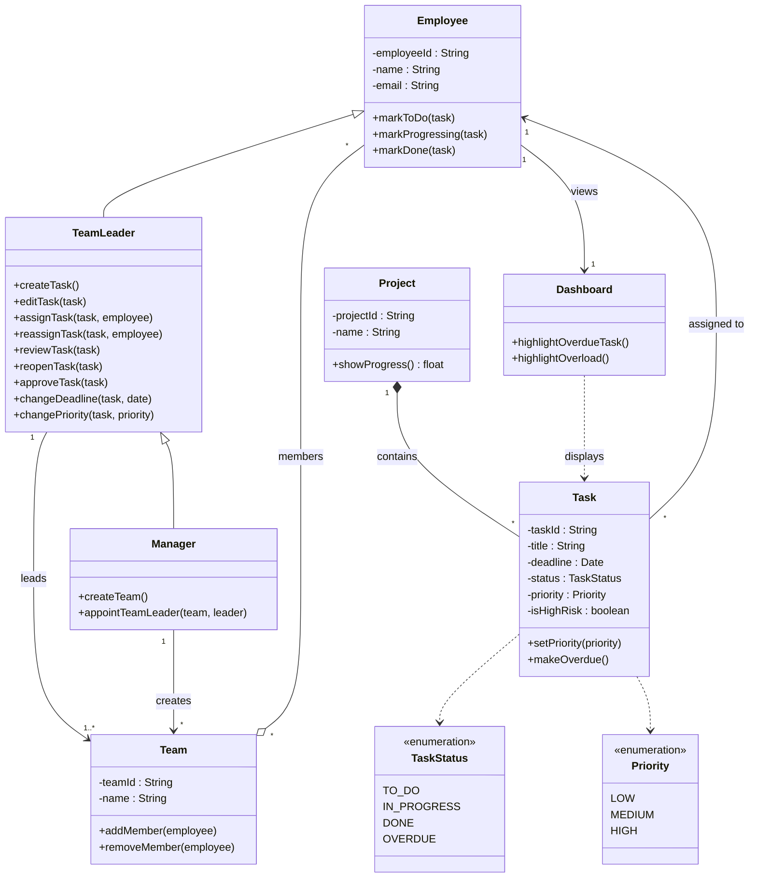
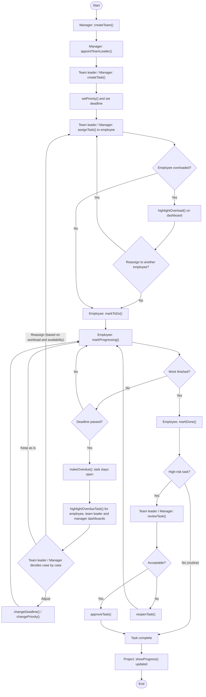
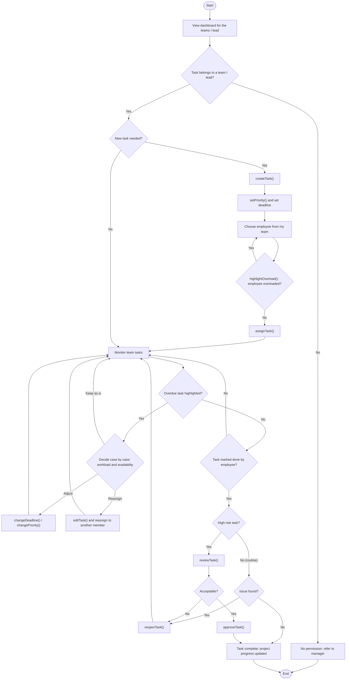
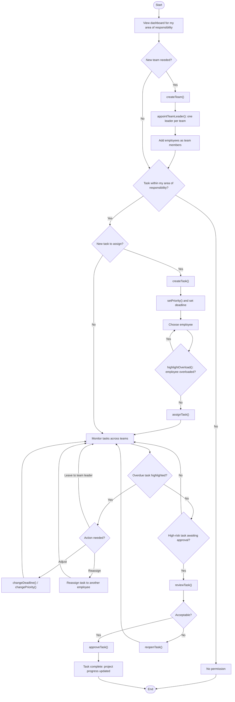

# Team-11-Project
# Project Task Management System
COB290 Group Project, Team 11. Productivity and knowledge management system, Part 1 prototype.

Author: Nicole Wong · Team: Team 11 · Status: in progress

This project is the design of a task management system for project work. Managers and team leaders create, assign and oversee project tasks. Employees update the status of the tasks assigned to them. This README contains the requirements, the role summaries, the UML class diagram and the flowcharts.

## Contents

1. [Requirements](#requirements)
2. [Roles](#roles)
3. [Class Diagram](#class-diagram)
4. [Flowcharts](#flowcharts)
5. [Design Decisions](#design-decisions)

## Requirements

| Requirement | Methods |
|-------------|---------|
| A project reflects the progress of its tasks | `showProgress()` |
| Employees mark their own tasks as complete; routine tasks need no approval | `markToDo()`, `markProgressing()`, `markDone()` |
| Team leaders and managers review and reopen tasks, and approve high-risk tasks | `reviewTask()`, `reopenTask()`, `approveTask()` |
| Deadlines can be adjusted and tasks have priority levels, changed only within the user's area of responsibility | `changeDeadline()`, `changePriority()`, `setPriority()` |
| Tasks are assigned by managers and team leaders; employees cannot assign tasks and there is no automatic allocation | `assignTask()` |
| Team leaders view, create, edit, assign and reassign tasks within the teams they lead | `createTask()`, `editTask()` |
| Overdue tasks stay open and are highlighted to the employee, team leaders and managers on their dashboards | `makeOverdue()`, `highlightOverdueTask()` |
| Team leaders handle unfinished tasks case by case, considering workload and availability; managers can also reassign tasks | `reassignTask()` |
| One person can lead several teams, but each team has exactly one team leader | – |
| Managers create teams and appoint team leaders | `createTeam()`, `appointTeamLeader()` |
| There is no limit on the number of projects per employee; the system highlights potential overload | `highlightOverload()` |

## Roles

### Employee
- Works on the tasks assigned to them. Employees cannot create or assign project tasks.
- Updates the status of their own tasks: `markToDo()`, `markProgressing()`, `markDone()`.
- Can complete routine tasks without approval.
- Sees their own overdue tasks highlighted on their dashboard.
- Has no fixed limit on the number of projects they work on.

### Team Leader
- Views, creates, edits, assigns and reassigns tasks within the teams they lead.
- Reviews, reopens and approves tasks. Approval is required for high-risk tasks.
- Changes deadlines and priorities within their teams.
- Decides case by case how to handle unfinished tasks, considering team members' workload and availability.
- Can lead several teams at once.

### Manager
- Has all of a team leader's task powers across their whole area of responsibility, including reassigning tasks.
- Is the only role that can create teams and appoint team leaders.
- Sees overdue tasks and potential employee overload across their area.

**Summary:** the employee carries out tasks, the team leader manages tasks within their teams, and the manager oversees the structure and can step in on any task in their area.

## Class Diagram

| Class | Purpose | Key methods |
|-------|---------|-------------|
| `Employee` | Base class for all staff | `markToDo()`, `markProgressing()`, `markDone()` |
| `TeamLeader` | Extends `Employee` with task management | `createTask()`, `editTask()`, `assignTask()`, `reassignTask()`, `reviewTask()`, `reopenTask()`, `approveTask()`, `changeDeadline()`, `changePriority()` |
| `Manager` | Extends `TeamLeader` with team management | `createTeam()`, `appointTeamLeader()` |
| `Team` | A group of employees led by one team leader | `addMember()`, `removeMember()` |
| `Project` | Contains tasks and reports overall progress | `showProgress()` |
| `Task` | A unit of work with status, priority and deadline | `setPriority()`, `makeOverdue()` |
| `Dashboard` | Highlights overdue tasks and overload | `highlightOverdueTask()`, `highlightOverload()` |
| `TaskStatus` | Enumeration | `TO_DO`, `IN_PROGRESS`, `DONE`, `OVERDUE` |
| `Priority` | Enumeration | `LOW`, `MEDIUM`, `HIGH` |

## Flowcharts

### Task Lifecycle

This flowchart follows one task from creation to completion across all three roles.

### Team Leader

This flowchart shows the team leader's actions, limited to the teams they lead.

### Manager

This flowchart shows the manager's actions across their area of responsibility, including creating teams and appointing team leaders.

## Design Decisions

- **Inheritance chain:** `Manager` extends `TeamLeader`, which extends `Employee`. Managers can do everything team leaders can, plus create teams and appoint leaders.
- **High-risk approval:** the `isHighRisk` attribute on `Task` decides whether approval is needed. Routine tasks are complete as soon as the employee marks them done.
- **Overdue tasks stay open:** `makeOverdue()` sets the status to `OVERDUE` without closing the task, so it stays visible until it's resolved.
- **No automatic allocation:** only managers and team leaders assign tasks, and they do it manually.
- **No project limit:** there's no cap on how many projects an employee can work on. `highlightOverload()` gives a warning but never blocks an assignment.
- **Scope of authority:** a team leader's methods apply only to tasks in teams they lead. A manager's methods apply to their whole area of responsibility.
