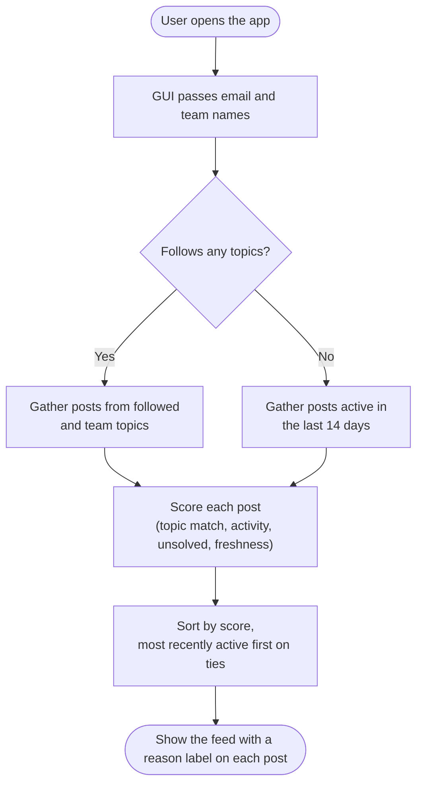
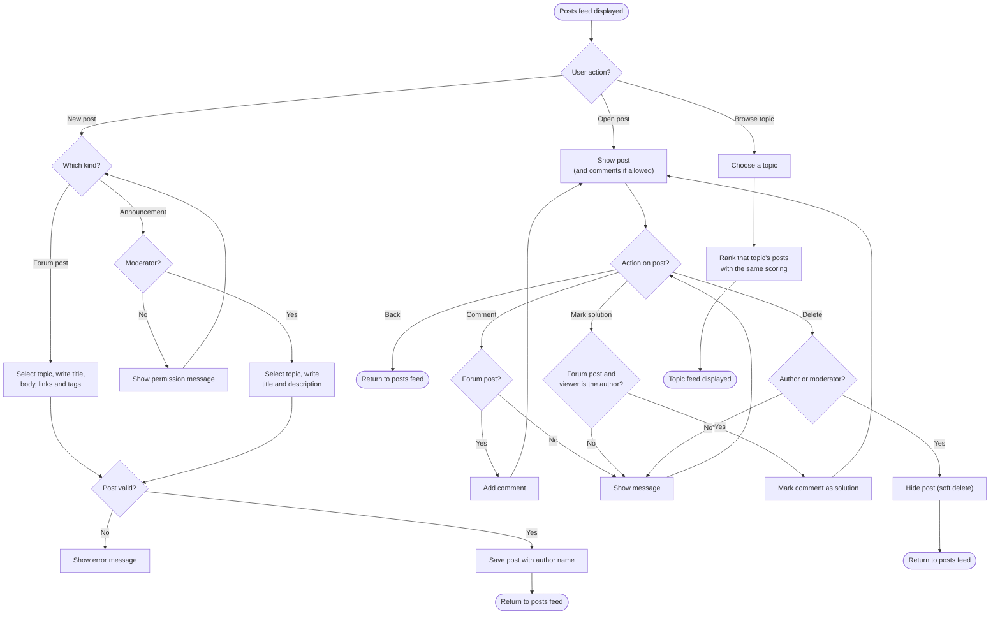
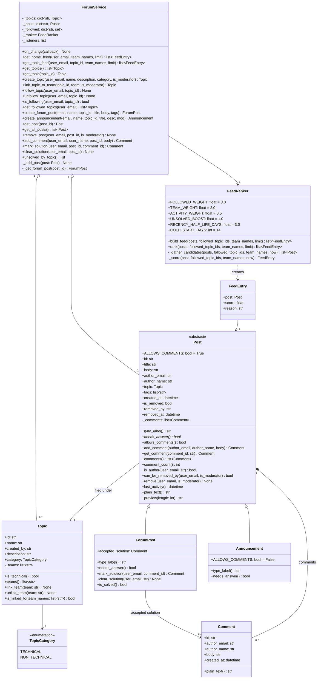

# Forums and Knowledge Base

**Author:** Dominic Stachura · **Team:** Team 11 · **Status:** ready for review

Lets employees share technical knowledge (configs, bugs, fixes) and non-technical knowledge (admin processes) as **posts** filed under **topics** such as *Software Issues* or *Printing*. There are two kinds of post:

- **Forum posts:** questions and discussions. Anyone can write one, anyone can comment, and the author can mark a comment as the accepted solution.
- **Announcements:** a title and description only, with no comments. Only moderators (Managers and Team Leaders) can post them.

Employees can follow topics and remove their own posts. Moderators can remove any post and manage topics.

The **ranked posts feed is the default home page**. It orders posts by how relevant their topic is to the user, how much discussion they have, whether they are unsolved technical questions, and how recently they were active.

This folder is **logic only**: no screens and no GUI imports. The GUI talks to one class, `ForumService`.

## Tech stack

- **Language:** Python
- **GUI:** CustomTkinter
- **Editor:** VS Code
- **Data:** held in memory for Part 1 (no database or login)

## How it works

### Building the feed



### What a user can do from the feed



The GUI shows the comment box only when `post.allows_comments()` is True, and the "Mark as solution" button only on forum posts the viewer wrote. The logic refuses these actions anyway if a button is shown by mistake.

Search is built by another team member. It searches the posts returned by `get_all_posts()`.

### How a post is scored

```
score = (1 + topic + activity + unsolved) x freshness

topic     = 3.0 if the user follows the topic, 2.0 if it's one of their team's topics, else 0
activity  = 0.5 x log(1 + number of comments)
unsolved  = 1.0 if post.needs_answer(): a technical forum post with no accepted solution, else 0
freshness = 0.5 ^ (days since last activity / 3)
```

The reason label shown on each post is whichever part added the most, for example *From a topic you follow* or *Unsolved in Printing*. The weights are settings at the top of `FeedRanker` in `forum_feed.py`.

## How to plug it into the GUI

**1. Create one service when the app starts** and share it with every screen:

```python
from forums import ForumService, ForumError

forum = ForumService()
```

For demos, use the sample data instead:

```python
from forums.forum_sample_data import SAMPLE_USERS, build_sample_forum

forum = build_sample_forum()
user = SAMPLE_USERS["lena"]   # pretend Lena is logged in
```

**2. Tell it how to refresh your screen.** It calls this after every change:

```python
forum.on_change(refresh_forum_screen)   # your own function, no arguments
```

**3. Draw the home feed** using the logged-in user's email and team names. Both kinds of post appear in the same feed:

```python
from forums import ForumPost

for entry in forum.get_home_feed(user_email, team_names):
    post = entry.post
    print(post.type_label(), post.title, post.author_name, post.preview(), entry.reason)
    if isinstance(post, ForumPost):
        print(post.comment_count(), "comments", "Solved" if post.is_solved() else "")
```

**4. Wire up buttons**, catching `ForumError` to show a friendly message:

```python
try:
    forum.create_forum_post(user_email, user_name, topic_id, title, body, tags)
    forum.create_announcement(user_email, user_name, topic_id, title, description,
                              is_moderator=is_moderator)
    forum.add_comment(user_email, user_name, post_id, "Try restarting the router")
    forum.mark_solution(user_email, post_id, comment_id)
    forum.remove_post(user_email, post_id, is_moderator=is_moderator)
except ForumError as error:
    show_error_popup(str(error))   # your GUI's own pop-up
```

**5. Hide buttons the user can't use:**

```python
show_delete = post.can_be_removed_by(user_email, is_moderator)
show_comment_box = post.allows_comments()
show_mark_solution = isinstance(post, ForumPost) and post.is_author(user_email)
follow_text = "Unfollow" if forum.is_following(user_email, topic_id) else "Follow"
```

**6. Showing post bodies.** Bodies are Markdown text: `**bold**`, `*italic*`, `[link text](https://...)` and `# Heading`. CustomTkinter's `CTkTextbox` doesn't allow fonts on text tags, so use a plain `tkinter.Text` widget to display a post. Use tags for bold and headings, and `tag_bind` with `webbrowser.open` for clickable links.

## What you can call on `ForumService`

Methods that act for someone take the logged-in user's email first.

| Method | What it does |
|--------|--------------|
| `get_home_feed(email, team_names, limit)` | Ranked home page posts, as `FeedEntry` objects |
| `get_topic_feed(email, topic_id, team_names, limit)` | Ranked posts in one topic (browse by topic) |
| `get_topics()` | Every topic, A to Z |
| `get_topic(topic_id)` | One topic |
| `create_topic(email, name, description, category, is_moderator)` | New topic (moderators only) |
| `link_topic_to_team(topic_id, team, is_moderator)` | Show a topic's posts to a team in their feed (moderators only) |
| `follow_topic(email, topic_id)` / `unfollow_topic(email, topic_id)` | Follow or stop following a topic |
| `is_following(email, topic_id)` | Whether to show Follow or Unfollow |
| `get_followed_topics(email)` | The user's followed topics, A to Z |
| `create_forum_post(email, name, topic_id, title, body, tags)` | Publish a forum post; the logged-in user is always the author |
| `create_announcement(email, name, topic_id, title, description, is_moderator)` | Publish an announcement (moderators only) |
| `get_post(post_id)` | Open a post (removed posts count as not found) |
| `get_all_posts()` | Every visible post, newest first (used by search) |
| `remove_post(email, post_id, is_moderator)` | Author removes their own, moderators any (soft delete) |
| `add_comment(email, name, post_id, body)` | Reply to a forum post (announcements refuse comments) |
| `mark_solution(email, post_id, comment_id)` | Accept a comment as the solution (forum post author only) |
| `clear_solution(email, post_id)` | Remove the accepted solution (forum post author only) |
| `unsolved_by_topic()` | Technical forum posts still needing an answer, per topic, most first, for managers |
| `on_change(function)` | Runs your function after every change |

**Useful on each `FeedEntry`:** `post`, `score`, `reason`

**Useful on every post:** `id`, `title`, `body`, `author_name`, `author_email`, `topic`, `tags`, `created_at`, `type_label()`, `allows_comments()`, `needs_answer()`, `comments()`, `comment_count()`, `is_author()`, `can_be_removed_by()`, `preview()`, `plain_text()`, `last_activity()`

**Only on forum posts:** `accepted_solution`, `is_solved()`, `mark_solution()`, `clear_solution()`

**Useful on each topic:** `id`, `name`, `description`, `category`, `is_technical()`, `teams()`

**Useful on each comment:** `id`, `author_name`, `author_email`, `body`, `created_at`

## Errors

All errors inherit from `ForumError`, so `except ForumError` catches everything.

| Error | When |
|-------|------|
| `ValidationError` | Blank title, body, description, comment, name or topic name, a bad email, a duplicate topic name, commenting on an announcement, or marking a solution on one |
| `TopicNotFoundError` | No topic with that ID |
| `PostNotFoundError` | No post with that ID, or it has been removed |
| `CommentNotFoundError` | No comment with that ID on the post |
| `AccessDeniedError` | Not allowed, e.g. removing someone else's post, or a non-moderator creating a topic or announcement |

## What the forum needs from other parts of the system

The forum doesn't create or manage users, roles or teams. The GUI passes in:

| Value | Comes from | Used for |
|-------|-----------|----------|
| `user_email` | Login | Who is acting; staff email is the unique identifier |
| `user_name` | Login | Shown as the author of posts and comments |
| `is_moderator` | Roles and permissions | True for Managers and Team Leaders (and anyone given moderation rights) |
| `team_names` | Teams | Posts in a team's topics get the team boost in the feed |

## Class diagram



Parameter names are shortened in the diagram (`mod` is `is_moderator`). `Post` is abstract: it can't be created on its own, and every subclass must write `type_label()` and `needs_answer()` (marked `*`). The feed only ever calls methods that `Post` defines, so a new kind of post can be added without changing the feed or the service's storage.

## Design decisions

- **Post types through inheritance.** `Post` is an abstract base class holding everything posts share. `ForumPost` adds accepted solutions; `Announcement` turns comments off with one class setting (`ALLOWS_COMMENTS = False`). Each answers `needs_answer()` in its own way, so the feed boosts open questions without checking which kind of post it has (polymorphism).
- **Users identified by email.** As the client asked, and matching the personal to-do list. The forum stores the author's email and name on each post and comment, so posts are never anonymous.
- **Moderation.** The client has no Admin role. Managers and Team Leaders moderate by default, and anyone else can be given moderation rights by the roles system. The GUI passes `is_moderator`, which defaults to `False` so forgetting it is always safe. Moderators can also create topics, which stops near-duplicates like "Printer" and "Printers" splitting posts up, and post announcements.
- **Soft delete.** Removing a post hides it from the feed and `get_all_posts()`, but keeps it with who removed it and when, in case a removal is questioned.
- **Markdown bodies.** The client requires formatting and links. Markdown is plain text, so it's simple to store and search, and the post screen formats it.
- **Cold start.** A user who follows nothing, or whose topics have no posts yet, sees everything active in the last 14 days, so the home page is never empty.
- **Ranking uses last activity.** A new comment brings an older post back up the feed.
- **Unsolved boost.** Open technical forum posts are pushed up so they get answered faster. Announcements never get it.
- **Topic-level insight only.** `unsolved_by_topic()` counts per topic, never per person, so it can't be used to target individuals. It helps managers see where training might be needed, which the original brief asks for.

## Files

## What you can call on `ForumService`

Methods that act for someone take the logged-in user's email first. Every ID is a string (`str`), so store `post.id`, `topic.id` or `comment.id` on your widget and pass it back in.

### Feed

| Method | What it does | Returns | Can raise |
|--------|--------------|---------|-----------|
| `get_home_feed(email, team_names=None, limit=20)` | Ranked posts for the home page | `list[FeedEntry]`, best first. Never empty if any posts exist | Nothing |
| `get_topic_feed(email, topic_id, team_names=None, limit=20)` | Ranked posts in one topic (browse by topic) | `list[FeedEntry]`, best first. Empty if the topic has no posts | `TopicNotFoundError` |

### Topics

| Method | What it does | Returns | Can raise |
|--------|--------------|---------|-----------|
| `get_topics()` | Every topic, for drop-downs and topic lists | `list[Topic]`, A to Z | Nothing |
| `get_topic(topic_id)` | One topic | `Topic` | `TopicNotFoundError` |
| `create_topic(email, name, description="", category=TopicCategory.TECHNICAL, is_moderator=False)` | New topic (moderators only) | The new `Topic` | `AccessDeniedError`, `ValidationError` |
| `link_topic_to_team(topic_id, team, is_moderator=False)` | Show a topic's posts to a team in their feed (moderators only) | The updated `Topic` | `AccessDeniedError`, `TopicNotFoundError`, `ValidationError` |
| `follow_topic(email, topic_id)` | Follow a topic | Nothing (`None`) | `TopicNotFoundError` |
| `unfollow_topic(email, topic_id)` | Stop following a topic | Nothing (`None`) | Nothing |
| `is_following(email, topic_id)` | Whether to show Follow or Unfollow | `bool` | Nothing |
| `get_followed_topics(email)` | The user's followed topics | `list[Topic]`, A to Z | Nothing |

### Posts

| Method | What it does | Returns | Can raise |
|--------|--------------|---------|-----------|
| `create_forum_post(email, name, topic_id, title, body, tags=None)` | Publish a forum post; the logged-in user is always the author | The new `ForumPost` | `TopicNotFoundError`, `ValidationError` |
| `create_announcement(email, name, topic_id, title, description, is_moderator=False)` | Publish an announcement (moderators only) | The new `Announcement` | `AccessDeniedError`, `TopicNotFoundError`, `ValidationError` |
| `get_post(post_id)` | Open a post | `ForumPost` or `Announcement` (check with `isinstance`) | `PostNotFoundError` (also if removed) |
| `get_all_posts()` | Every visible post (used by search) | `list[Post]`, newest first, both kinds mixed | Nothing |
| `remove_post(email, post_id, is_moderator=False)` | Author removes their own, moderators any (soft delete) | Nothing (`None`) | `PostNotFoundError`, `AccessDeniedError` |

### Comments and solutions

| Method | What it does | Returns | Can raise |
|--------|--------------|---------|-----------|
| `add_comment(email, name, post_id, body)` | Reply to a forum post | The new `Comment` | `PostNotFoundError`, `ValidationError` (blank, or the post is an announcement) |
| `mark_solution(email, post_id, comment_id)` | Accept a comment as the solution (forum post author only) | The `Comment` now marked as the solution | `PostNotFoundError`, `CommentNotFoundError`, `AccessDeniedError`, `ValidationError` (announcement) |
| `clear_solution(email, post_id)` | Remove the accepted solution (forum post author only) | Nothing (`None`) | `PostNotFoundError`, `AccessDeniedError`, `ValidationError` (announcement) |

### Other

| Method | What it does | Returns | Can raise |
|--------|--------------|---------|-----------|
| `unsolved_by_topic()` | Technical forum posts still needing an answer, for managers | `list[tuple[Topic, int]]`, most first, e.g. `[(printing, 3), (issues, 1)]`. Topics with none are left out | Nothing |
| `on_change(function)` | Runs your function (no arguments) after every successful change | Nothing (`None`) | Nothing |

### Parameter types

| Parameter | Type | Notes |
|-----------|------|-------|
| `email` | `str` | Logged-in user's staff email; capitals and spaces don't matter |
| `name` | `str` | Logged-in user's display name, saved as the author |
| `topic_id`, `post_id`, `comment_id` | `str` | From `topic.id`, `post.id`, `comment.id` |
| `team_names` | `list[str]`, optional | The user's team names, e.g. `["Development"]` |
| `limit` | `int`, default 20 | Most posts a feed returns |
| `title`, `description` | `str` | Can't be blank |
| `body` | `str` | Markdown text; can't be blank |
| `tags` | `list[str]`, optional | Tidied automatically: `"#Printer"` becomes `"printer"`, repeats removed |
| `category` | `TopicCategory` | `TopicCategory.TECHNICAL` or `TopicCategory.NON_TECHNICAL` |
| `is_moderator` | `bool`, default `False` | From the roles system |

## What you get back

### `FeedEntry` (from the feeds)

| Attribute | Type | Use it for |
|-----------|------|-----------|
| `post` | `ForumPost` or `Announcement` | Everything shown on the card (see below) |
| `score` | `float` | How well it ranked; mainly for testing |
| `reason` | `str` | Small label on the card, e.g. `"From a topic you follow"` or `"Unsolved in Printing"` |

### Every post (`ForumPost` and `Announcement`)

| Attribute or method | Type | Use it for |
|---------------------|------|-----------|
| `id` | `str` | Store on the widget; pass to `get_post`, `add_comment` etc. |
| `title` | `str` | Card and page heading |
| `body` | `str` | Full Markdown text for the post page (an announcement's description) |
| `author_name` | `str` | "Posted by" |
| `author_email` | `str` | Comparing with the logged-in user |
| `topic` | `Topic` | `post.topic.name` for the topic label |
| `tags` | `list[str]` | Tag chips (always empty for announcements) |
| `created_at` | `datetime` | "Posted on" date, e.g. `post.created_at.strftime("%d %b %Y")` |
| `type_label()` | `str` | Badge: `"Forum post"` or `"Announcement"` |
| `allows_comments()` | `bool` | Whether to show the comment box |
| `needs_answer()` | `bool` | Whether to show an "Unanswered" badge |
| `comments()` | `list[Comment]` | The comment thread, oldest first (always empty for announcements) |
| `comment_count()` | `int` | "3 comments" on the card |
| `is_author(email)` | `bool` | Whether the logged-in user wrote it |
| `can_be_removed_by(email, is_moderator)` | `bool` | Whether to show the delete button |
| `preview(length=150)` | `str` | Short plain-text snippet for the card, cut at a whole word with `...` |
| `plain_text()` | `str` | Body with Markdown symbols removed |
| `last_activity()` | `datetime` | When it was posted or last commented on |

### Only on `ForumPost`

| Attribute or method | Type | Use it for |
|---------------------|------|-----------|
| `accepted_solution` | `Comment` or `None` | Highlight that comment in the thread |
| `is_solved()` | `bool` | "Solved" badge |

### `Topic`

| Attribute or method | Type | Use it for |
|---------------------|------|-----------|
| `id` | `str` | Store on the drop-down or list item |
| `name` | `str` | Display name, e.g. `"Printing"` |
| `description` | `str` | Shown under the name (may be empty) |
| `category` | `TopicCategory` | `topic.category.value` gives `"technical"` or `"non-technical"` |
| `is_technical()` | `bool` | Technical or not |
| `teams()` | `list[str]` | Names of the teams it's linked to |
| `created_by` | `str` | Email of the moderator who made it |

### `Comment`

| Attribute or method | Type | Use it for |
|---------------------|------|-----------|
| `id` | `str` | Pass to `mark_solution` |
| `author_name` | `str` | "Reply from" |
| `author_email` | `str` | Comparing with the logged-in user |
| `body` | `str` | Markdown text of the reply |
| `created_at` | `datetime` | When it was posted |
| `plain_text()` | `str` | Body with Markdown symbols removed |

## Running

From the repo root:

```
python -m forums.forum_sample_data   # print every sample user's home feed
python -m unittest -v                # run the tests
```

## Notes

- Data is held in memory for the Part 1 prototype and resets when the app closes. Only the storage inside `forum_gui_service.py` would need changing for a database in Part 2.
- Search, users, roles and teams are built by other team members. See "What the forum needs from other parts of the system" above.
