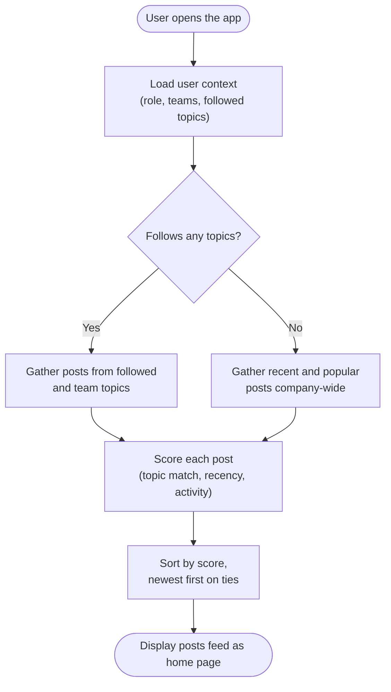
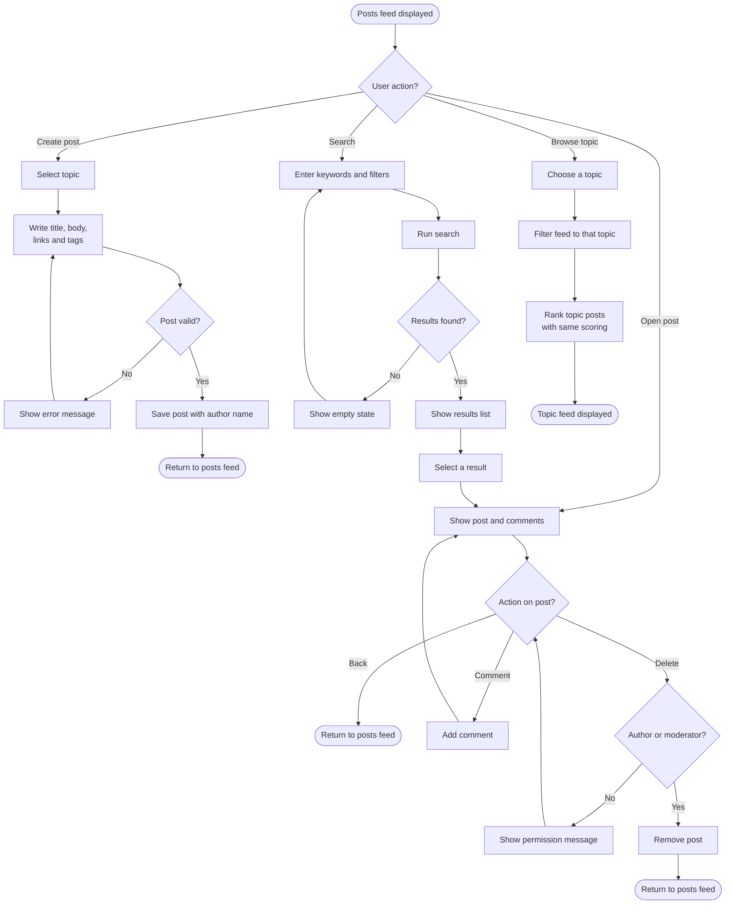
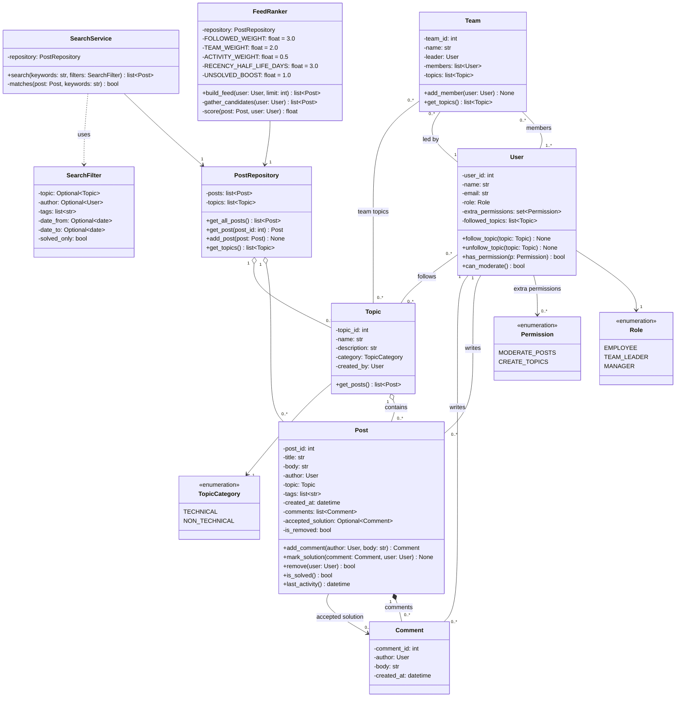

# Team-11-Project
# Forums and Knowledge Base

**COB290 Group Project, Team 11. Productivity and knowledge management system, Part 1 prototype.**

**Author:** Dominic Stachura · **Team:** Team 11 · **Status:** in progress

This README covers the design of the **Posts** section. The algorithm-ranked posts feed is the **default home page** of the app, so it's the first thing every user sees.

Employees share technical knowledge (configs, bugs, fixes) and non-technical knowledge (admin processes) as **Posts** inside **Topics** such as *Software Development* or *Printing*. The feed ranks posts by relevance to the user, how recent they are and how much discussion they have. From the feed, users can create posts, open and comment on them, search, or browse a single topic.

## Tech stack

- **Language:** Python
- **GUI:** PySide6
- **Editor:** VS Code
- **Data:** dummy data only for Part 1 (no live database or login)

In VS Code, select the `.venv` interpreter with **Python: Select Interpreter** from the Command Palette.

## Progress so far

| Item | Status |
|---|---|
| Flow diagram: feed generation | Done |
| Flow diagram: user actions from the feed | Done |
| Class diagram | Done |
| Pseudocode for feed, posting, moderation and search | Done |
| Dummy data (users, teams, topics, posts, comments) | To do |
| PySide6 screens: feed, post view, create post, search, topic view | To do |
| Link the feed home page into the team's navigation | To do |

---

## Diagram 1: Posts feed generation

If a user doesn't follow any topics yet, the feed falls back to recent and popular posts so the home page is never empty.



## Diagram 2: User actions from the feed

From the feed the user can take one of four paths. Every path ends back at a feed.
- Create post: pick a topic, write the post, validate and publish.
- Open post: read the post, comment on it, or delete it if they have permission.
- Search: enter keywords and filters, then open a result. This goes to the same post view as opening a post from the feed.
- Browse topic: show the feed filtered to a single topic, ranked with the same scoring.



## Diagram 3: Class diagram
Diagram 3: Class diagram

The classes fall into three layers:

- People and permissions: User, Team, Role, Permission
- Knowledge base: Topic, Post, Comment, TopicCategory
- Logic and data: FeedRanker, SearchService, SearchFilter, PostRepository



---

## Design decisions

- **Moderation:** Managers can moderate by default, and anyone else can be given the `MODERATE_POSTS` permission individually. Authors can always delete their own posts.
- **Soft delete:** removing a post sets `is_removed = True` instead of deleting it, so it can still be audited.
- **Cold-start fallback:** users who follow no topics see recent and popular posts instead of an empty feed.
- **Ranking uses last activity:** an old post that gets a new comment moves back up the feed.
- **Unsolved boost:** open technical questions are pushed up so they get answered faster.

---

## Pseudocode

### Building the feed

```
FUNCTION build_feed(user, limit):
    candidates = gather_candidates(user)
    SORT candidates BY score(post, user) DESCENDING, THEN BY last_activity DESCENDING
    RETURN first <limit> posts


FUNCTION gather_candidates(user):
    all_posts = every post WHERE is_removed IS FALSE

    IF user.followed_topics IS EMPTY:
        RETURN posts in all_posts active within the last 14 days

    relevant_topics = user.followed_topics + topics of the user's teams
    RETURN posts in all_posts whose topic IS IN relevant_topics
```

### Scoring a post

The whole score is multiplied by a freshness value that halves every 3 days, so old posts sink unless someone comments again.

```
FUNCTION score(post, user):
    IF post.topic IN user.followed_topics:    topic_score = 3.0
    ELSE IF post.topic IN user's team topics: topic_score = 2.0
    ELSE:                                     topic_score = 0

    activity_score = 0.5 * log(1 + number of comments)

    IF post is TECHNICAL AND NOT post.is_solved():  unsolved_score = 1.0
    ELSE:                                           unsolved_score = 0

    age_in_days = (now - post.last_activity()) in days
    freshness = 0.5 ^ (age_in_days / 3)

    RETURN (1 + topic_score + activity_score + unsolved_score) * freshness
```

### Creating a post

```
FUNCTION create_post(user, topic, title, body, tags):
    IF topic, title or body IS BLANK:
        SHOW error message
        RETURN nothing

    post = NEW Post(title, body, topic, tags, author = user, created_at = now)
    repository.add_post(post)
    RETURN post
```

### Deleting and moderating

```
FUNCTION can_moderate(user):
    RETURN user.role IS MANAGER OR MODERATE_POSTS IN user.extra_permissions

FUNCTION remove(post, user):
    IF user IS post.author OR can_moderate(user):
        post.is_removed = TRUE
        RETURN TRUE
    SHOW permission message
    RETURN FALSE
```

### Searching

```
FUNCTION search(keywords, filters):
    words = lowercase(keywords) split on spaces
    results = empty list

    FOR EACH post NOT removed:
        IF post fails any filter (topic, author, tags, dates, solved only): SKIP

        hits = 0
        FOR EACH word IN words:
            IF word IN post.title: hits += 2     # title matches count double
            IF word IN post.body:  hits += 1
            IF word IN post.tags:  hits += 1

        IF words IS EMPTY OR hits > 0: ADD (hits, post) TO results

    SORT results BY hits DESCENDING, THEN BY newest
    RETURN posts from results
```

---

## Ideas to make the section stand out

**Recommended**

- **"Why am I seeing this?" labels:** each feed post shows its biggest scoring reason, such as *From a topic you follow* or *Unsolved in Printing*.
- **Similar post detection:** while a title is being typed, show existing posts with similar titles using `difflib`, to cut down on duplicate questions.
- **Knowledge-gap insight:** show managers which topics have the most unsolved posts, to help spot where training is needed.

**Also worth considering**

- **Post templates:** prefill the editor with headings for a Fix, How-to or Config post.
- **"Might be out of date" flag:** old technical posts show a warning and a *Still accurate* button.
- **Related posts on tasks:** show matching posts on a project task's detail screen.
- **Quick search:** Ctrl+K opens search from anywhere using `QShortcut`.

---

## Diagram source files

Editable versions are in `docs/diagrams/`: `posts_feed_generation.drawio`, `posts_feed_user_actions.drawio` and `posts_class_diagram.drawio`. Import them into Visual Paradigm Online with **Diagram > Open From Device**, then **File > Save as > VP Online**. They also open in [draw.io](https://app.diagrams.net).
