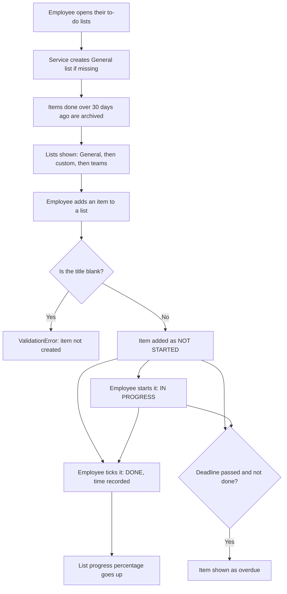

# Personal To-Do List

**Author:** Brandon Richardson · **Team:** Team 11 · **Status:** ready for review

Lets each employee keep their own to-do lists: a **General** list for loose items, **custom** lists (e.g. "Training") and one list per **team**. Employees can add items, update progress, tick items off, and see what's overdue. Items finished more than 30 days ago are archived automatically.

This folder is **logic only**: no screens and no GUI imports. The GUI talks to one class, `PersonalTodoService`.

## How it works



## How to plug it into the GUI

**1. Create one service when the app starts** and share it with every screen:

```python
from personal_todo import PersonalTodoService, Priority, Status, TodoError

todo_service = PersonalTodoService()
```

**2. Tell it how to refresh your screen.** It calls this after every change:

```python
todo_service.on_change(refresh_todo_screen)   # your own function, no arguments
```

**3. Draw the lists** using the logged-in user's email:

```python
for todo_list in todo_service.get_lists(user_email):      # General is always first
    print(todo_list.name, todo_list.progress(), "%")
    for item in todo_list.items():
        print(item.title, item.priority.value, item.status.value, item.is_overdue())
```

**4. Wire up buttons**, catching `TodoError` to show a friendly message:

```python
try:
    todo_service.create_list(user_email, "Training")               # custom list
    todo_service.create_team_list(user_email, "Team X")            # team list
    todo_service.add_item(user_email, list_id, "Order printer paper", priority=Priority.HIGH)
    todo_service.tick_item(user_email, list_id, item_id)
except TodoError as error:
    show_error_popup(str(error))   # your GUI's own pop-up
```

## What you can call on `PersonalTodoService`

Every method takes the logged-in user's email first.

| Method | What it does |
|--------|--------------|
| `get_lists(email)` | All the user's lists: General, then custom lists, then teams (A to Z) |
| `get_general_list(email)` | Just the General list |
| `create_list(email, name)` | New custom list not tied to a team, e.g. "Training" |
| `create_team_list(email, team)` | New list for a team (one per team) |
| `delete_list(email, list_id)` | Deletes a custom or team list (General can't be deleted) |
| `add_item(email, list_id, title, description, deadline, priority)` | Adds an item; only `title` is required |
| `edit_item(email, list_id, item_id, title, description, deadline, priority)` | Changes only what you pass in |
| `update_status(email, list_id, item_id, Status.IN_PROGRESS)` | Progress update |
| `tick_item(email, list_id, item_id)` | Marks an item as done |
| `delete_item(email, list_id, item_id)` | Deletes an item |
| `get_all_items(email)` | Every item across all lists |
| `get_overdue_items(email)` | Items past their deadline and not done |
| `on_change(function)` | Runs your function after every change |

**Useful on each list:** `name`, `team`, `is_general()`, `is_team_list()`, `items()`, `progress()`, `archived_items()`

**Useful on each item:** `id`, `title`, `description`, `deadline`, `priority`, `status`, `completed_at`, `is_overdue()`

## Errors

All errors inherit from `TodoError`, so `except TodoError` catches everything.

| Error | When |
|-------|------|
| `ValidationError` | Blank title or name, duplicate list name or team, or deleting General |
| `ListNotFoundError` | No list with that ID |
| `ItemNotFoundError` | No item with that ID in the list |
| `AccessDeniedError` | The list belongs to a different employee |

## Files

| File | What it contains |
|------|------------------|
| `__init__.py` | The public API: import everything from `personal_todo` |
| `service.py` | `PersonalTodoService`, the one class the GUI uses |
| `models.py` | `TodoItem`, `TodoList`, `Status` and `Priority` |
| `exceptions.py` | `TodoError` and the errors above |

## Notes

- Data is held in memory for the Part 1 prototype and resets when the app closes. Only the storage inside `service.py` would need changing for a database in Part 2.
- Personal items are separate from project tasks assigned by managers or team leaders (client Q&A, Q7).