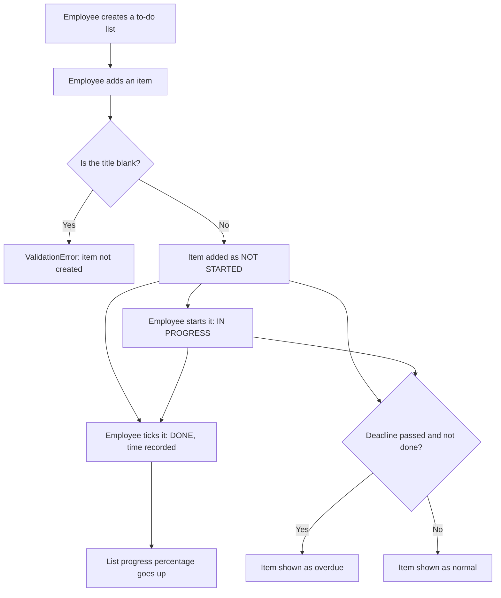

# Personal To-Do List

**Author:** Brandon Richardson · **Team:** Team 11 · **Status:** in progress

This folder contains the logic for the personal to-do list. Employees can create their own lists, add items, update progress and tick items off. It contains no screens: the team's GUI calls these classes.

## Files

| File | What it contains |
|------|------------------|
| `exceptions.py` | Custom errors, all based on `TodoError`, so the GUI can catch any error from this component and show a friendly message |
| `models.py` | `Status` and `Priority` (fixed options), `TodoItem` (one item) and `TodoList` (a group of items) |
| `__init__.py` | Marks the folder as a Python package so it can be imported |

## What's done so far

- **`TodoItem`**: an item with a title, optional description, deadline and priority (low, medium, high). It starts as *not started* and can be moved to *in progress*, ticked as *done* (recording the time), or reopened. It is overdue if its deadline has passed and it isn't done.
- **`TodoList`**: a named list owned by one employee (by staff email). Items can be added, found, removed and listed, and the list can be renamed. `progress()` gives the percentage of items done.
- **Validation**: blank titles and list names are rejected with a `ValidationError`. Asking for an item that doesn't exist raises `ItemNotFoundError`.

## How it works



## Example

```python
from personal_todo.models import Priority, TodoItem, TodoList

work = TodoList("Website redesign", "brandon@make-it-all.co.uk")
item = TodoItem("Draft homepage copy", priority=Priority.HIGH)
work.add_item(item)

item.mark_done()
print(work.progress())   # 100.0
```

## Still to do

- `PersonalTodoService`: the single class the GUI will use
- Automated tests