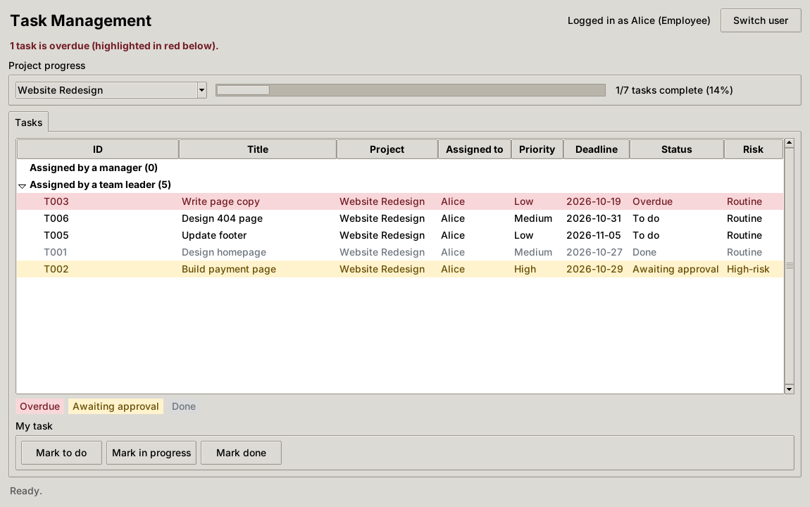
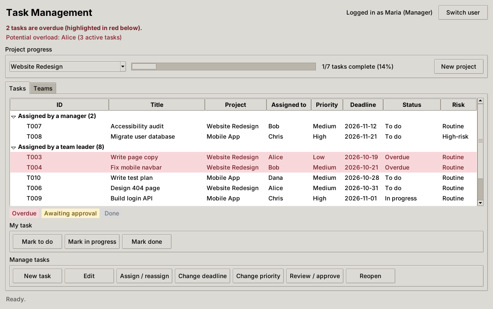
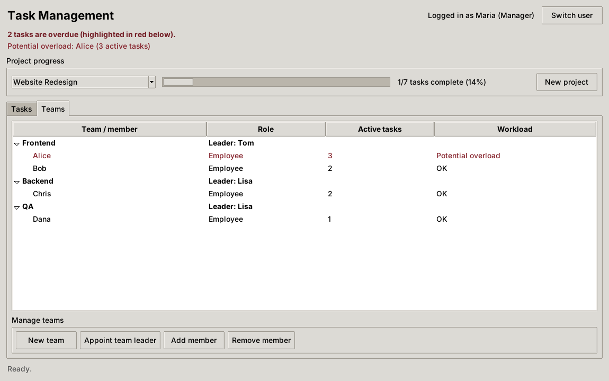
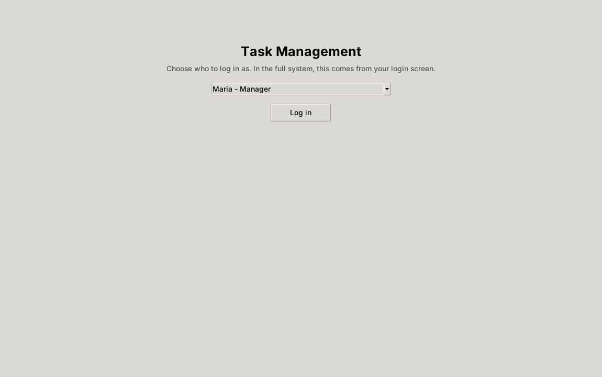
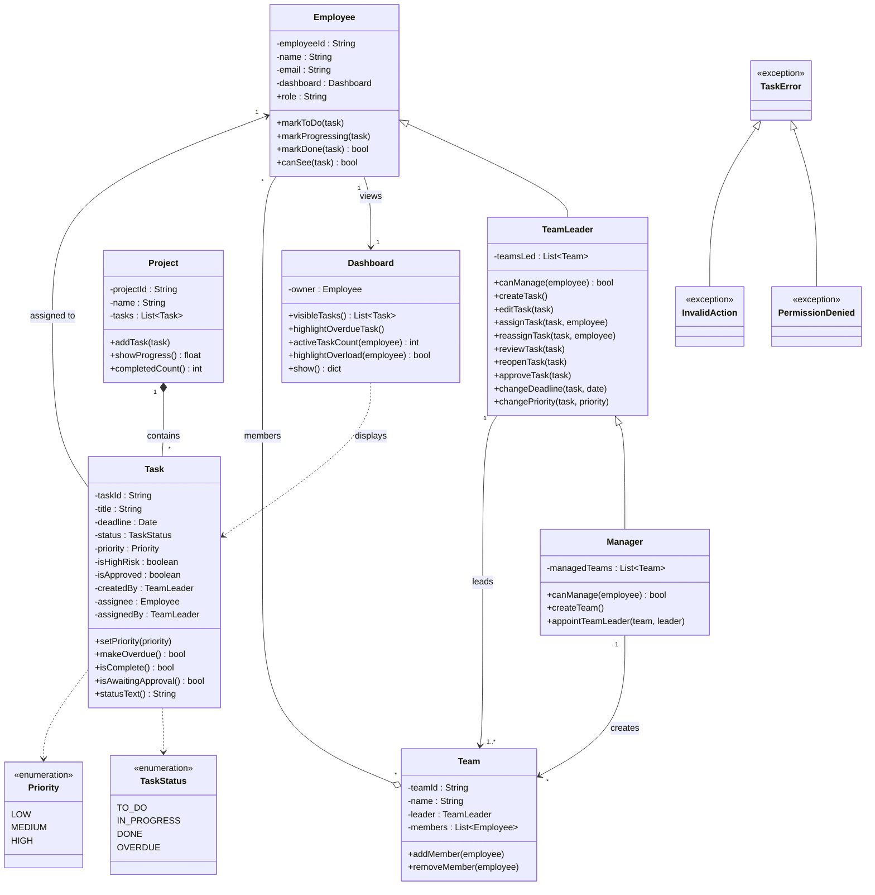
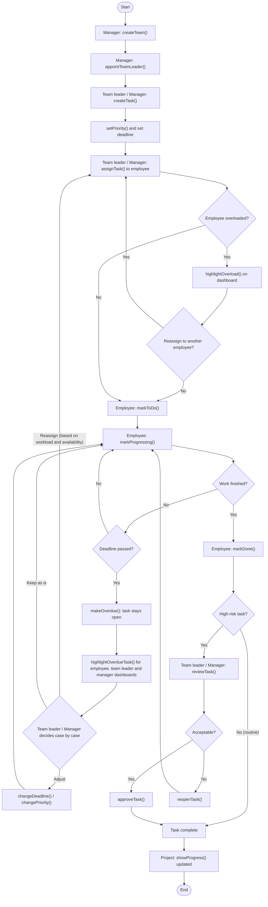
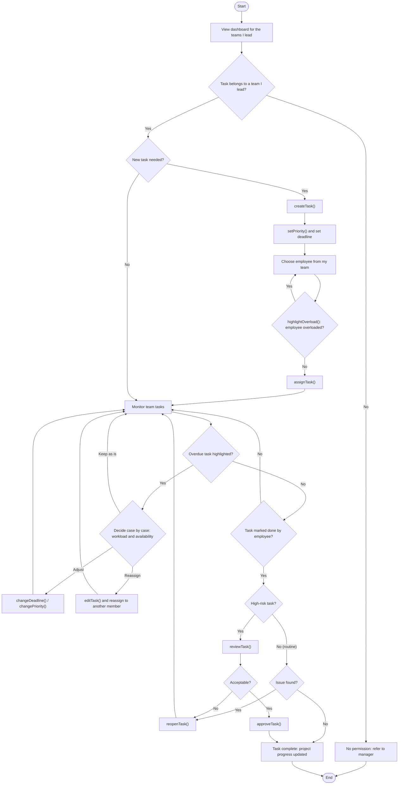
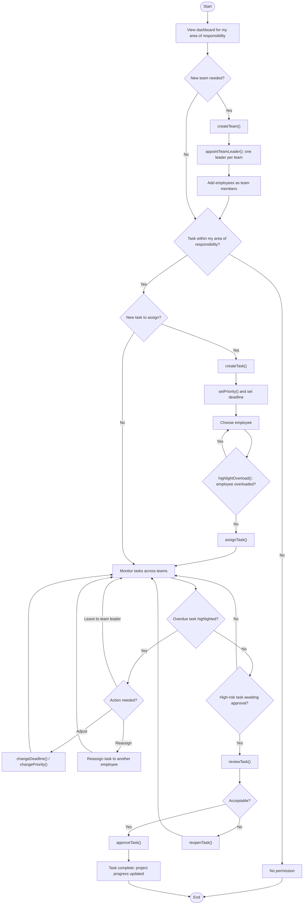

# Task Management Feature

The task management feature of the management system. Managers and team leaders create, assign and oversee project tasks, and employees update the tasks assigned to them. It's written in Python with object-oriented design and a Tkinter interface.

## Contents

1. [Features](#features)
2. [Screenshots](#screenshots)
3. [Getting Started](#getting-started)
4. [Project Structure](#project-structure)
5. [Linking to the Main System](#linking-to-the-main-system)
6. [Design](#design)
7. [Design Decisions](#design-decisions)
8. [Limitations](#limitations)

## Features

### Employee
- Sees only the tasks assigned to them.
- Marks their own tasks as to do, in progress or done.
- Completes routine tasks without approval. High-risk tasks are sent for approval.
- Sees overdue tasks highlighted in red.
- Cannot create or assign tasks.

### Team Leader
Has everything an employee can do, plus the following, within the teams they lead:
- Creates, edits, assigns and reassigns tasks.
- Changes deadlines and priorities.
- Reviews high-risk tasks, then approves them or reopens them for more work. Can also reopen routine tasks.
- Sees each member's active task count and potential overload, to decide case by case how to handle unfinished tasks.
- Can lead several teams. Each team has exactly one team leader.

### Manager
Has everything a team leader can do, across their whole area of responsibility, plus:
- Creates projects and teams.
- Appoints team leaders and adds or removes team members.
- Reassigns tasks across teams.

### Everyone
- Overdue tasks stay open and are highlighted for the employee, their team leader and their manager.
- Tasks assigned by a manager are listed separately from those assigned by a team leader.
- Project progress is shown as a progress bar.
- Potential overload is flagged when an employee has 3 or more active tasks. This is a warning only, since there's no limit on how many projects an employee can work on.

## Screenshots

| Employee | Manager |
|----------|---------|
|  |  |

| Manager: teams | Log in |
|----------------|--------|
|  |  |

## Getting Started

### Requirements
- Python 3.10 or later
- Tkinter, for the GUI only. It's included with Python on Windows and macOS. On Linux, install it with `sudo apt install python3-tk`.

No third-party packages are needed.

### Run the app
```bash
python main.py
```
Choose a user on the log-in screen to see the feature from that role. The sample data includes a manager (Maria), two team leaders (Tom and Lisa) and five employees. Some tasks are already overdue, one is awaiting approval and one employee is near overload, so every feature can be seen straight away.

### Run without the GUI
```bash
python demo.py
```
Runs through every feature in the terminal, in the same order as the flowcharts. It only uses `models.py`, so Tkinter isn't needed.

### Run the tests
```bash
python -m unittest
```
The tests don't need Tkinter either.

## Project Structure

```
task-management-system/
├── main.py                     # Runs the Tkinter app with sample data
├── demo.py                     # Command-line demo, no GUI needed
├── task_management/
│   ├── __init__.py
│   ├── models.py               # Classes and rules (no GUI code)
│   ├── gui.py                  # Tkinter interface
│   └── sample_data.py          # Sample people, teams, projects and tasks
├── tests/
│   └── test_models.py          # Unit tests for every requirement
└── docs/
    ├── class_diagram.pdf
    ├── task_lifecycle_flowchart.pdf
    ├── team_leader_flowchart.pdf
    ├── manager_flowchart.pdf
    ├── diagrams/               # Mermaid source for each diagram
    └── screenshots/
```

The logic in `models.py` is kept separate from the interface in `gui.py`. Model methods never print. They return values or raise a `TaskError`, which the GUI shows in a message box. The rules can therefore be tested without the GUI, and reused with a different interface later.

## Linking to the Main System

`TaskManagementView` is a normal `ttk.Frame`, so it can be placed in any window or tab of the main management system:

```python
from task_management import Manager, TeamLeader, Employee
from task_management.gui import TaskManagementView

# current_user and all_people come from the main system's login and user records,
# as Manager, TeamLeader or Employee objects.
view = TaskManagementView(parent_frame, current_user, all_people)
view.pack(fill="both", expand=True)
```

The view shows only the buttons the logged-in user's role allows. The rules are also checked in `models.py`, so an action that isn't allowed is always refused.

## Design

### Class Diagram



### Task Lifecycle



### Team Leader



### Manager



PDF versions of all four diagrams are in [`docs/`](docs/).

## Design Decisions

- **Inheritance chain:** `Manager` extends `TeamLeader`, which extends `Employee`. Each role can do everything the role below it can.
- **Overriding for scope:** `canManage()` limits a team leader to the teams they lead. `Manager` overrides it to cover every team it manages.
- **High-risk approval:** `isHighRisk` decides whether a finished task needs approval, and `isApproved` records it. Routine tasks are complete as soon as they're marked done.
- **Overdue tasks stay open:** `makeOverdue()` sets the status to `OVERDUE` without closing the task. It stays highlighted until the deadline is extended or the task is done.
- **No automatic allocation:** tasks are only assigned manually, and removing a team member returns their unfinished tasks for the team leader to handle case by case.
- **Separate handling by assigner:** each task records `assignedBy`, so dashboards list manager-assigned and team-leader-assigned tasks separately.

## Limitations

- Data is held in memory and resets when the app closes. Saving to a file or database would be added when linking to the main system.
- The log-in screen is a simple user picker for running the feature on its own. In the full system, the user comes from the main log-in.
